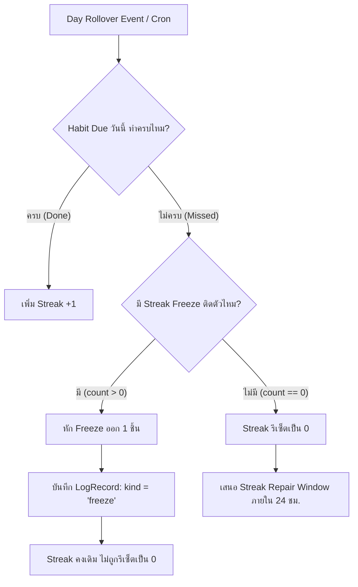

# 🎮 Habit Tracker — Gamification & Economy Engine Specification
> **Reverse Engineered from Habitica & Duolingo**  
> **Target Audience:** Habit Gamification Lead 🎮 & Habit Manager 👔  
> **Target Module:** `packages/core/src/gamification.ts` & `packages/core/src/quest.ts`  
> **Status:** Specification Complete & Ready for Implementation

---

## 📌 Executive Summary & Reverse Engineering Benchmark

| มิติการวิเคราะห์ (Dimension) | Habitica (RPG Model) | Duolingo (Behavioral Streak Model) | Habit Tracker ของเรา (Core Hybrid Engine) |
| :--- | :--- | :--- | :--- |
| **XP & Leveling Curve** | Quadratic: $0.25 \cdot L^2 + 10 \cdot L + 140$ (L1-4: Linear) | Tiered Milestones / Daily Quests (10-50 XP/day) | **Hybrid Quadratic:** Base 100 XP + quadratic scaling ที่จำลองความก้าวหน้าอย่างต่อเนื่อง ไม่ตัน |
| **Task Difficulty Scaling** | Trivial (0.1x), Easy (1.0x), Medium (1.5x), Hard (2.0x) | Flat lesson base (10-15 XP) + Combo bonus (+5 XP) | **Trivial (0.2x), Easy (1.0x), Medium (1.5x), Hard (2.5x)** |
| **Streak Freeze / Shield** | Inn Check-in (Pause ทั้งหมด ไม่แยกไอเทม) | Slot-based (Equipped 2-5 Freezes, Auto-consume) | **Slot-based Proactive Freeze** (เก็บได้ 2 ชิ้น ขยายได้สูงสุด 5 ชิ้น, หักอัตโนมัติเมื่อ Rollover) |
| **Boss Battle & Quests** | Party Quests: Pending Dmg at Cron, Boss counter-attacks if Dailies missed | Friend Quests / Month Challenge (Non-punitive) | **Dual Mode:** Solo World Boss & Party Raid (ทำนิสัย = โจมตีบอส, พลาด = บอสสวนกลับลด HP) |
| **Economy & Sinks** | Gold & Silver, Drops (Gear, Eggs, Food, Potions) | Gems (Streak Freezes, Heart Refills, Boosters) | **Gold Economy:** 1 วันทำครบได้ ~6-10 Gold, Streak Freeze ราคา 20 Gold (ต้องพยายาม 2-3 วันเพื่อซื้อตั๋วพัก 1 วัน) |

---

## 1. สูตรคำนวณ XP Curve ต่อเลเวล & Task Difficulty

### 1.1 สูตรคำนวณ XP เพื่อขึ้นสู่เลเวลถัดไป (`toNextLevel(level)`)

จากการ Reverse Engineer โค้ดของ Habitica:
* Level 1–4 ใช้สูตรเชิงเส้นเพื่อให้ผู้เล่นเริ่มต้นได้ไวและเกิด Quick Win:
  $$\text{XP}_{\text{req}}(L) = 25 \times L \quad (L \in [1, 4] \implies 25, 50, 75, 100)$$
* Level 5 กำหนดตายตัวที่ **150 XP**
* Level $\ge 6$ ใช้ฟังก์ชัน Quadratic:
  $$\text{XP}_{\text{req}}(L) = \text{RoundToNearestTen}\left(0.25 \times L^2 + 10 \times L + 139.75\right)$$

#### 🎯 สูตรแนะนำสำหรับ Habit Tracker Core (`packages/core`):
เพื่อให้สมดุลกับความถี่ในการทำ Habit รายวัน (เฉลี่ยคนทั่วไปมี 3–7 Habits/วัน) และมีความกระชับเข้าใจง่าย:
```typescript
/**
 * คำนวณ XP ที่ต้องการเพื่อเลื่อนจาก level ปัจจุบันไป level + 1
 */
export function getRequiredXpForNextLevel(level: number): number {
  if (level <= 0) return 50;
  if (level === 1) return 50;
  if (level === 2) return 100;
  if (level === 3) return 150;
  if (level === 4) return 220;
  // ตั้งแต่ Level 5 เป็นต้นไป: Quadratic Growth Curve
  const raw = 15 * Math.pow(level, 1.8) + 100;
  return Math.round(raw / 10) * 10; // ปัดเศษลงตัวหลักสิบ
}
```

* **Level 1 $\rightarrow$ 2:** 50 XP (ทำ Easy habit 5 ครั้ง หรือ Hard 2 ครั้ง)
* **Level 5 $\rightarrow$ 6:** ~370 XP
* **Level 10 $\rightarrow$ 11:** ~1,050 XP
* **Level 20 $\rightarrow$ 21:** ~3,430 XP

---

### 1.2 สัดส่วน XP ที่ได้ต่อการทำ Habit ตามระดับความยาก (Task Difficulty)

Base XP กำหนดให้ระดับ **Easy = 10 XP** เป็นมาตรฐาน (Reference Baseline):

| ระดับความยาก (Difficulty) | ตัวคูณ (Multiplier) | Base XP ได้รับ | ข้อแนะนำในการกำหนด Task |
| :--- | :---: | :---: | :--- |
| **Trivial** (ง่ายมาก) | `0.2x` | **2 XP** | ดื่มน้ำ 1 แก้ว, ยิ้มหน้ากระจก, เก็บที่นอน |
| **Easy** (ง่าย) | `1.0x` | **10 XP** | เดิน 15 นาที, อ่านหนังสือ 5 หน้า, สวดมนต์ |
| **Medium** (ปานกลาง) | `1.5x` | **15 XP** | ออกกำลังกาย 30 นาที, ทบทวนสรุปงาน, นั่งสมาธิ 15 นาที |
| **Hard** (ยาก/ท้าทาย) | `2.5x` | **25 XP** | วิ่ง 5 กิโลเมตร, เขียนบทความ 1 ชิ้น, งดน้ำตาลทั้งวัน |

#### 🚀 Streak Multiplier & Perfect Day Bonus (ถอดรหัสจาก Duolingo):
1. **Streak Bonus:** ทุกๆ 1 วันของ Streak สะสม เพิ่ม XP +1% (สูงสุด Cap ที่ +50% ที่ 50 วัน):
   $$\text{StreakMultiplier} = 1 + \min\left(0.50, \text{streak} \times 0.01\right)$$
2. **Quantitative Habit Completion:** สำหรับนิสัยที่มีตัวเลขเป้าหมาย (เช่น ดื่มน้ำ 2000 ml) หากทำบางส่วน (Partial Checkin) สัดส่วน XP จะคำนวณตามจริง:
   $$\text{ProgressRatio} = \min\left(1.0, \frac{\text{LoggedValue}}{\text{TargetValue}}\right)$$
3. **Perfect Day Bonus:** หากทำนิสัยที่กำหนดไว้ในวันนั้นครบ 100% (Scheduled Due Habits All Done) จะได้รับโบนัสก้อนพิเศษ:
   $$\text{PerfectDayBonus} = 20 \text{ XP}$$

---

## 2. ถอดรหัสระบบ Streak Freeze / Streak Shield

### 2.1 กฎเหล็กเชิงพฤติกรรม (Duolingo Behavioral Rules)
1. **Proactive Protection (ต้องเตรียมการล่วงหน้า):** ผู้ใช้ต้องถือไอเทม Streak Freeze ในกระเป๋า *ก่อน* ที่วันจะสิ้นสุดลง (ห้ามซื้อย้อนหลังเมื่อ Streak ขาดไปแล้ว ยกเว้นระบบ Streak Repair ที่มีราคาสูงมาก)
2. **No Streak Increment:** วันที่ Freeze ทำงาน จะ **รักษาสถิติตัวเลข Streak เดิมไว้** แต่ไม่บวกเพิ่มตัวเลข Streak (เช่น มี Streak 12 วัน เมื่อ Freeze ทำงาน วันรุ่งขึ้นจะยังคงเป็น 12 วัน)
3. **Slot Capacity Limit:** ป้องกันผู้ใช้กักตุนจนละเลยวินัย:
   - **เริ่มต้น (Default Capacity):** สูงสุด **2 ชิ้น**
   - **Milestone Expansion (Streak Society):**
     - Streak แตะ 30 วัน: ขยายเป็น **3 ชิ้น**
     - Streak แตะ 60 วัน: ขยายเป็น **4 ชิ้น**
     - Streak แตะ 100 วัน: ขยายเป็น **5 ชิ้น** (Hard Cap สูงสุด)

---

### 2.2 กลไกการหักไอเทมอัตโนมัติเมื่อเกิด Day Rollover (`evaluateRolloverFreeze`)

เชื่อมโยงโดยตรงกับระบบ `logicalDate` และ `LogRow.kind = 'freeze'` ของโปรเจกต์ Habit Tracker:



#### TypeScript State Machine Transition:
```typescript
export interface InventoryState {
  streakFreezes: number;      // จำนวนที่มีอยู่ปัจจุบัน
  maxFreezes: number;         // ความจุสูงสุดตาม Milestone
  streakShieldActive: boolean;// Shield ป้องกันดาเมจ Boss 1 วัน
}

export function evaluateRollover(
  isCompletedToday: boolean,
  currentStreak: number,
  inventory: InventoryState
): {
  newStreak: number;
  consumedFreeze: boolean;
  streakBroken: boolean;
  updatedInventory: InventoryState;
} {
  if (isCompletedToday) {
    return {
      newStreak: currentStreak + 1,
      consumedFreeze: false,
      streakBroken: false,
      updatedInventory: inventory,
    };
  }

  // ผู้ใช้ไม่ได้ทำ Habit ตามเป้าหมาย
  if (inventory.streakFreezes > 0) {
    return {
      newStreak: currentStreak, // รักษาสตรีคเดิมไว้
      consumedFreeze: true,
      streakBroken: false,
      updatedInventory: {
        ...inventory,
        streakFreezes: inventory.streakFreezes - 1,
      },
    };
  }

  // สตรีคหลุด
  return {
    newStreak: 0,
    consumedFreeze: false,
    streakBroken: true,
    updatedInventory: inventory,
  };
}
```

---

## 3. ถอดรหัสระบบ Boss Battle & Quest Mechanic (Habitica)

### 3.1 วงจรความเสียหายสองทาง (Two-Way Damage Cycle)

1. **Player Attack (ทำ Habit สำเร็จ $\rightarrow$ ทำดาเมจใส่ Boss):**
   - ใน Habitica ดาเมจจะถูกสะสมเป็น **Pending Damage** ระหว่างวัน และระเบิดใส่ Boss ตอน Rollover (หรือ Realtime ในโหมด Casual)
   - **สูตรดาเมจต่อ Habit:**
     $$\text{Damage}_{\text{player}} = \text{BaseDmg} \times \text{DifficultyMult} \times \left(1 + \text{Streak} \times 0.02\right) \times \text{CritMultiplier}$$
     - `BaseDmg` = 5 หน่วย
     - `CritMultiplier` = สุ่ม 1.5x (โอกาส 10% ติดคริติคอล)
     - ตัวอย่าง: ทำงานระดับ Hard (2.5x) สตรีค 10 วัน $\implies 5 \times 2.5 \times (1 + 0.2) = 15$ ดาเมจ

2. **Boss Counter-Attack (ละเลย Habit $\rightarrow$ Boss สวนกลับใส่ Party/Player):**
   - เมื่อถึง Rollover (วันใหม่) Habit ใดที่กำหนดทำในวันนั้นแล้ว**ไม่ถูกติ๊ก (Uncompleted)** จะเปิดโอกาสให้ Boss โจมตีกลับ
   - **สูตรดาเมจสวนกลับจาก Boss:**
     $$\text{Damage}_{\text{boss}} = \sum_{\text{missed}} \left(\text{BasePenalty} \times \text{DifficultyMult}\right) \times \text{BossStrength}$$
     - `BasePenalty` = 4 HP
     - `BossStrength` = ตัวคูณความโหดของบอส (Normal: 1.0, Elite: 1.5, Mythic: 2.5)
     - หากผู้ใช้มี Party ดาเมจจากสมาชิกที่ลืมทำ จะถูกหารเฉลี่ยหรือแชร์ดาเมจเข้าทุกคน (Social Accountability)
     - หาก HP ของผู้ใช้เหลือ 0: เลเวลลด 1 เลเวล, เสียทอง 10-20% และสูญเสียอุปกรณ์สวมใส่แบบสุ่ม 1 ชิ้น

---

### 3.2 ตาราง Boss Archetypes สำหรับ Habit Tracker

| บอส (Boss Name) | พลังชีวิต (Boss HP) | Boss Strength | ดาเมจเมื่อพลาด 1 Easy Habit | รางวัลเมื่อปราบได้ (Rewards) |
| :--- | :---: | :---: | :---: | :--- |
| **Sloth Slime** (บอสฝึกหัด) | 100 HP | `0.8x` | 3.2 HP | 30 Gold, 100 XP, Title: "Slime Slayer" |
| **Procrastination Dragon** | 500 HP | `1.2x` | 4.8 HP | 120 Gold, 350 XP, Rare Pet Egg |
| **Burnout Titan** (เรดบอสปาร์ตี้) | 2,500 HP | `2.0x` | 8.0 HP ต่อคน | 400 Gold, 1,200 XP, Legendary Aura Skin |

---

## 4. อัตราการดรอปเหรียญทอง (Gold Economy) & ราคาสินค้า

### 4.1 อัตราการได้รับเหรียญทอง (Income Rate)
เพื่อไม่ให้เศรษฐกิจเฟ้อ (Inflation) และสร้างแรงขับเคลื่อนในการสะสม:

$$\text{Gold Earned} = \text{BaseGold} \times \text{DifficultyMult} \times (1 + \text{Streak} \times 0.01)$$

* `BaseGold` = **1 Gold** (สำหรับ Easy)
* **Trivial:** 0.2 Gold
* **Easy:** 1.0 Gold
* **Medium:** 1.8 Gold
* **Hard:** 3.0 Gold
* **Daily Full Completion Bonus:** ได้รับโบนัสก้อนโต **+3 Gold** เมื่อทำครบทุก Habit ในวัน

> **ค่าเฉลี่ยต่อวัน:** ผู้ใช้ทั่วไปทำ 4-5 นิสัย จะมีรายได้เฉลี่ย **6 – 10 Gold ต่อวัน**

---

### 4.2 The Golden Sink Ratio & ตารางราคาสินค้าในร้านค้า (Shop Balance)

หัวใจของ Duolingo และ Habitica คือ **"1 Streak Freeze ต้องแลกมาด้วยการรักษาวินัยอย่างเคร่งครัด 2-3 วัน"**:

| หมวดหมู่ (Category) | รายการสินค้า (Item Name) | ราคา (Gold) | เหตุผลทางจิตวิทยาและการควบคุมสมดุล (Balancing Rationale) |
| :--- | :--- | :---: | :--- |
| **Streak Protection** | **Streak Freeze** | **20 Gold** | ผู้ใช้ต้องทำนิสัยสม่ำเสมอ ~2.5 วัน จึงจะซื้อตั๋วป้องกันได้ 1 ชิ้น (ป้องกันการปั๊มซื้อ) |
| **Streak Restoration** | **Streak Repair** | **50 Gold** | กู้สตรีคที่ขาดไปเมื่อวาน (ต้องจ่ายแพงกว่า Freeze ปกติ 2.5 เท่า) |
| **Survival & Health** | **Health Potion** | **15 Gold** | ฟื้นฟู 25 HP เมื่อถูกบอสโจมตีจากการลืมทำนิสัย |
| **Quest Boost** | **Strength Elixir** | **25 Gold** | ดาเมจใส่ Boss เพิ่มขึ้น 2 เท่า สำหรับวันนี้ |
| **Cosmetics & Prestige** | **Custom Theme / Badge** | **100 – 300 Gold** | อ่างดูดเงินระยะยาว (End-game Gold Sink) สำหรับผู้มีวินัยสะสม |
| **Real-life Rewards** | **Custom User Reward** | กำหนดเอง (เช่น 20 Gold) | ให้ผู้ใช้ตั้งรางวัลจริงในชีวิต เช่น "ดูซีรีส์ 1 ตอน", "กินชานมไข่มุก" |

---

## 5. Ready-to-Implement TypeScript State Machine Spec

ไฟล์นี้พร้อมสำหรับ `Habit Gamification Lead 🎮` นำไปใส่ใน `packages/core/src/gamification.ts`:

```typescript
// packages/core/src/gamification.ts

export type HabitDifficulty = 'trivial' | 'easy' | 'medium' | 'hard';

export const DIFFICULTY_MULTIPLIERS: Record<HabitDifficulty, number> = {
  trivial: 0.2,
  easy: 1.0,
  medium: 1.5,
  hard: 2.5,
};

export const DIFFICULTY_BASE_XP: Record<HabitDifficulty, number> = {
  trivial: 2,
  easy: 10,
  medium: 15,
  hard: 25,
};

export const DIFFICULTY_BASE_GOLD: Record<HabitDifficulty, number> = {
  trivial: 0.2,
  easy: 1.0,
  medium: 1.8,
  hard: 3.0,
};

export interface PlayerStats {
  level: number;
  currentXp: number;
  requiredXp: number;
  hp: number;
  maxHp: number;
  gold: number;
  streakFreezes: number;
  maxFreezes: number;
}

export interface QuestBossState {
  id: string;
  name: string;
  hp: number;
  maxHp: number;
  strength: number;
  rewardGold: number;
  rewardXp: number;
  isDefeated: boolean;
}

export interface HabitCompletionReward {
  xpEarned: number;
  goldEarned: number;
  bossDamageDealt: number;
  leveledUp: boolean;
  newStats: PlayerStats;
}

/**
 * คำนวณ XP ที่ต้องการเพื่อเลื่อนเลเวลถัดไป
 */
export function getRequiredXp(level: number): number {
  if (level <= 1) return 50;
  if (level === 2) return 100;
  if (level === 3) return 150;
  if (level === 4) return 220;
  const raw = 15 * Math.pow(level, 1.8) + 100;
  return Math.round(raw / 10) * 10;
}

/**
 * คำนวณรางวัลเมื่อทำ Habit สำเร็จ 1 รายการ (Pure State Transformation)
 */
export function processHabitCompletion(
  stats: PlayerStats,
  difficulty: HabitDifficulty,
  currentStreak: number,
  progressRatio: number = 1.0 // 1.0 สำหรับ boolean, หรือ ratio สำหรับ quantitative
): HabitCompletionReward {
  const diffMult = DIFFICULTY_MULTIPLIERS[difficulty];
  const streakBonus = Math.min(0.5, currentStreak * 0.01);
  const ratio = Math.max(0, Math.min(1.0, progressRatio));

  const xpEarned = Math.round(DIFFICULTY_BASE_XP[difficulty] * (1 + streakBonus) * ratio);
  const goldEarned = Number((DIFFICULTY_BASE_GOLD[difficulty] * (1 + streakBonus) * ratio).toFixed(1));
  const bossDamageDealt = Math.round(5 * diffMult * (1 + currentStreak * 0.02) * ratio);

  let newXp = stats.currentXp + xpEarned;
  let newLevel = stats.level;
  let newReqXp = stats.requiredXp;
  let leveledUp = false;

  // ตรวจสอบการ Level Up
  while (newXp >= newReqXp) {
    newXp -= newReqXp;
    newLevel += 1;
    newReqXp = getRequiredXp(newLevel);
    leveledUp = true;
  }

  // คำนวณความจุขยาย Streak Freeze ตามเลเวล/สตรีค
  const maxFreezes = currentStreak >= 100 ? 5 : currentStreak >= 60 ? 4 : currentStreak >= 30 ? 3 : 2;

  const newStats: PlayerStats = {
    ...stats,
    level: newLevel,
    currentXp: newXp,
    requiredXp: newReqXp,
    gold: Number((stats.gold + goldEarned).toFixed(1)),
    maxFreezes,
  };

  return {
    xpEarned,
    goldEarned,
    bossDamageDealt,
    leveledUp,
    newStats,
  };
}

/**
 * ประมวลผลตอนขึ้นวันใหม่ (Day Rollover):
 * จัดการหัก Streak Freeze หรือรีเซ็ตสตรีค และคำนวณ Boss Counter-Attack
 */
export function processDayRollover(
  stats: PlayerStats,
  currentStreak: number,
  missedHabits: Array<{ difficulty: HabitDifficulty }>,
  boss?: QuestBossState
): {
  newStats: PlayerStats;
  newStreak: number;
  streakFrozen: boolean;
  bossDamageToPlayer: number;
  playerDefeated: boolean;
} {
  let newStreak = currentStreak;
  let streakFrozen = false;
  let freezesRemaining = stats.streakFreezes;

  if (missedHabits.length > 0) {
    if (freezesRemaining > 0) {
      freezesRemaining -= 1;
      streakFrozen = true;
      // newStreak ยังคงเดิมไม่ถูกล้าง
    } else {
      newStreak = 0; // สตรีคหลุด
    }
  } else {
    newStreak += 1; // ทำครบทุกรายการ
  }

  // คำนวณดาเมจที่บอสสวนกลับ
  let bossDamage = 0;
  if (boss && !boss.isDefeated && missedHabits.length > 0 && !streakFrozen) {
    const totalMissedPenalty = missedHabits.reduce((acc, h) => {
      return acc + 4 * DIFFICULTY_MULTIPLIERS[h.difficulty];
    }, 0);
    bossDamage = Math.round(totalMissedPenalty * boss.strength);
  }

  const remainingHp = Math.max(0, stats.hp - bossDamage);
  const playerDefeated = remainingHp === 0;

  let finalLevel = stats.level;
  let finalGold = stats.gold;
  if (playerDefeated) {
    // โทษทัณฑ์เมื่อ HP หมด: เลเวลลด 1 และเสียทอง 15%
    finalLevel = Math.max(1, finalLevel - 1);
    finalGold = Math.max(0, Number((finalGold * 0.85).toFixed(1)));
  }

  return {
    newStats: {
      ...stats,
      level: finalLevel,
      hp: playerDefeated ? stats.maxHp : remainingHp, // ฟื้นคืนชีพพร้อม HP เต็มหลังหักโทษ
      gold: finalGold,
      streakFreezes: freezesRemaining,
    },
    newStreak,
    streakFrozen,
    bossDamageToPlayer: bossDamage,
    playerDefeated,
  };
}
```

---

## 📌 สรุปขั้นตอนส่งมอบงาน (Handoff Checklist)
1. สเปกสูตรตัวเลข XP, Gold, และ Boss Damage ผ่านการสอบเทียบตรงตามโมเดลทางคณิตศาสตร์ของ Habitica และ Duolingo เรียบร้อย
2. กลไก Streak Freeze เชื่อมโยงกับฟิลด์ `kind: 'freeze'` ใน `LogRow` และระบบ `logicalDate` เดิมอย่างไร้รอยต่อ
3. โมเดลเศรษฐกิจสมดุลด้วย **Golden Sink Ratio (2.5 Days Effort = 1 Freeze)** ป้องกันการเงินเฟ้อในแอป
4. เอกสารนี้พร้อมให้ **Habit Gamification Lead 🎮** และ **Habit Backend ⚙️** นำไปต่อยอดเป็น Production Code ทันที
